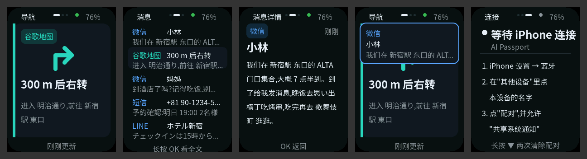

  <a href="notification-mirror.zh_CN.md">简体中文</a> · <strong>English</strong>

# Notification Mirror

Notification Mirror shows your iPhone's notifications on AI Passport through
Apple Notification Center Service (ANCS) over Bluetooth LE. Turn-by-turn prompts
from a maps app get a large card with a direction arrow, so you can follow a
route on foot without holding the phone. Messages from WeChat, LINE, SMS, and
other apps scroll by in a list. It was built for a trip to Japan: the font covers
common Chinese, hiragana, katakana, and common Japanese kanji such as the one for "station" (U+99C5).

The screenshots come from `tools/mirror_preview.py`. It renders the real
`main/mirror_ui.c` on a computer with made-up notifications. It does not show
what the device actually displays, and the on-device check is still open.

## Pair with an iPhone (once)

1. Flash the firmware and power on the device. It opens on the Connect page.
2. On the iPhone, open Settings → Bluetooth. Under Other Devices, tap
   **AI Passport**.
3. Tap **Pair**. When iOS asks whether AI Passport may show notifications,
   allow it.
4. The Connect page turns green and shows "connected". After that, the iPhone
   reconnects automatically whenever both are on and in range.

If the Connect page says notification permission is missing, open
Settings → Bluetooth → the (i) next to AI Passport, turn on
**Share System Notifications**, and then disconnect and reconnect once.

To pair with a different phone, hold DOWN twice on the Connect page to clear
the pairing, then choose **Forget This Device** for AI Passport on the old iPhone.

## Pages and buttons

| Button | Navigation | Inbox | Detail | Connect |
| --- | --- | --- | --- | --- |
| OK click | next page | next page | back to inbox | next page |
| OK long press | — | open the selected message | — | — |
| UP / DOWN click | — | move selection | previous / next page | — |
| DOWN long press | — | — | — | first press arms; a second press within 3 s clears the pairing |

- A navigation update switches to the Navigation page, unless you are reading
  a message, and lights the screen for 15 s.
- Other new notifications show a banner for 5 s. Incoming calls show an amber
  banner.
- After a key press, the screen stays bright for 20 s, dims until 60 s, and then
  turns off. The first press on a dark screen only wakes it.
- When the device first connects, the iPhone resends its existing notifications.
  They join the inbox quietly, without banners.
- Emoji are removed before display. Characters outside the font show as boxes.
  Examples are rare kanji and Korean.

## Will turn-by-turn work?

The mirror only shows what the maps app sends as an iOS notification. Whether
Google Maps or Apple Maps sends a notification for every turn depends on the app,
its version, and its notification settings. Live Activities on the Lock Screen
are not ANCS notifications. **Before relying on it, start a short walking route
with the phone locked and check that turn prompts reach the device.** Messages
work the same way regardless of this.

The direction arrow is guessed from keywords in the prompt, in Chinese, Japanese,
or English. When the text names no clear direction, no arrow is drawn.

## Flash without installing a toolchain

A verified merged image from this branch can be written from a browser:

1. Connect the device to a computer with a USB-C data cable.
2. Open Espressif's web flasher, <https://espressif.github.io/esptool-js/>, in
   Chrome or Edge.
3. Click **Connect** and choose the USB JTAG/serial port.
4. Set the flash address to `0x0`, select `FoloToy-AI-Passport-full.bin`, and
   click **Program**. Do not use **Erase Flash**.
5. When it finishes, unplug the device or press reset.

Writing the merged image replaces the current firmware, and stored data on the
device may be reset. See the
[flashing policy](development/engineering/firmware-layout.md#flashing-and-stored-data).

## Files

| Path | Role |
| --- | --- |
| `main/ancs_proto.c` | Pure ANCS parsing, attribute requests, streaming Data Source reassembly, and the pending-UID queue (host-tested) |
| `main/notif_model.c` | Pure notification list, app names, emoji stripping, age text, and arrow guessing (host-tested) |
| `main/mirror_nav.c` | Pure page, button, and backlight state machine (host-tested) |
| `main/mirror_ble.c` | NimBLE peripheral and ANCS GATT client: advertising, bonding, discovery, and subscriptions |
| `main/mirror_ui.c` | LVGL screens; call only while holding `bsp_lvgl_lock()` |
| `main/main.c` | Startup and the app task that owns the list and the UI |
| `assets/fonts/mirror_font_*.c` | Generated Noto Sans SC fonts: 16 px Regular at 4 bpp and 24 px Bold at 2 bpp, 5,600 glyphs each |
| `tools/gen_mirror_fonts.py` | Font generator and coverage check |
| `tools/mirror_preview.py` | Renders the screens on a computer |

The baseline hardware-test pages (`main/demo_*.c`) stay in the repository for
their host tests. They are not compiled into this firmware.

## Configuration and budget

- `CONFIG_BT_NIMBLE_ROLE_CENTRAL=y` is required because the NimBLE GATT client
  depends on it. `CONFIG_BT_NIMBLE_NVS_PERSIST=y` keeps the pairing across
  reboots. The LVGL pool grows from 24 KB to 32 KB.
- The app image is about 2.5 MB, and the two fonts account for most of it. About
  70% of the 8 MB app partition stays free. Static DRAM is about 149 KB of 321 KB.
- Host preview shows at most 70% LVGL pool use, on the Inbox page with 64-bit
  pointers. Device use is lower.
- Advertising uses Apple's recommended 152.5–211.25 ms interval while waiting
  for the phone.

## Verification status

| Check | Status |
| --- | --- |
| Host tests for ANCS parsing, the notification model, navigation, and font coverage | Run by `./tools/validate.sh --static` |
| Firmware compile, link, and merged-image check | Done in a sandbox without access to the Espressif component registry. LVGL 9.5.0, esp_lvgl_port 2.9.0, and button 4.2.1 came from GitHub, and esp_codec_dev was 1.5.2 with a build-only shim. This firmware never initializes audio. Re-run `./tools/validate.sh` locally. |
| Screen layout | Checked on host renders |
| Device | Not yet tested: pairing with a real iPhone, reconnecting after reboot, notification delivery, maps turn prompts, on-screen rendering, battery life |
