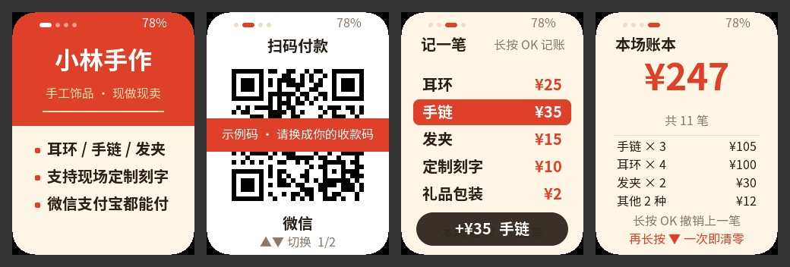

<p align="right">
  <a href="stall-badge.zh_CN.md">简体中文</a> · <strong>English</strong>
</p>

# Stall Badge

Stall Badge turns AI Passport into a wearable sign for market stalls, pop-up
shops, and freelance gigs. It shows your shop name and pitch, brings up your
payment QR code with one long press, and keeps a tally of what you sold during
the current session. The tally survives power loss.



The screenshots come from `tools/badge_preview.py`. It renders the real
`main/badge_ui.c` on a computer with the same corner mask as the device.
Rendering on the device itself still needs an on-device check.

## Pages and buttons

The four pages cycle in this order: Sign → Pay → Record → Ledger.

| Button | Sign | Pay | Record | Ledger |
| --- | --- | --- | --- | --- |
| OK click | next page | next page | next page | next page |
| OK long press | jump to Pay | back to Sign | **record the selected item** | **undo the last sale** |
| UP / DOWN click | brighter / dimmer | switch QR code | move selection | — |
| DOWN long press | — | — | — | first press arms clearing; a second press within 3 s clears the session |

Automatic behavior:

- The ledger page goes back to Sign after 15 s idle, so customers do not see your takings.
- The pay page stays at full brightness for scanning and goes back to Sign after 120 s idle.
- Other pages dim to 10% after 60 s idle. The first button press only wakes the screen.
- A rising chime confirms a sale, a falling one confirms an undo, and a low tone marks an error or a clear.
  Sound is optional. If audio fails to initialize, the badge keeps working without it.
- Battery level is shown at the top right. It is hidden when the fuel gauge cannot be read.

The device has no network clock, so the ledger counts per session instead of per
day. It holds totals per item and the last 32 sales for undo. Clear it when you
pack up.

## Put your own shop on it

1. Copy `main/badge_content.c` to `main/badge_content_local.c` and edit the
   copy. Git ignores the local file, so your payment codes are never committed.
   The build uses the local file whenever it exists.
2. Get the text inside your payment QR code. Scan your WeChat Pay or Alipay
   receiving code with any QR scanner app. Paste the decoded text, which usually
   starts with `wxp://` or `https://qr.alipay.com/`, into `payload`. Payloads
   that contain `example.com` are treated as placeholders. They are covered
   with a red "sample code" band so nobody pays to a fake link.
3. Enter prices in cents (`2500` is ¥25). The badge supports up to 8 items,
   4 pitch lines, and 2 payment codes. Keep each pitch line within 8 Chinese
   characters and the shop name within 7. Longer text ends with an ellipsis.
4. Regenerate the fonts. Only the characters the badge uses are compiled in,
   and new characters would otherwise show as boxes:

   ```bash
   python3 tools/gen_badge_fonts.py          # needs Node.js; downloads Noto Sans SC once
   python3 tools/gen_badge_fonts.py --check  # coverage check only, also run by validate.sh
   ```

5. Optionally preview the pages on your computer before flashing:

   ```bash
   python3 tools/badge_preview.py            # writes build/badge-preview/*.png
   ```

   This needs the LVGL sources that the first `idf.py build` downloads into
   `managed_components/`, or an LVGL 9.5 tree passed with `--lvgl`.

6. Build and flash as usual (see [build and test](development/engineering/build-and-test.md)).

## Ways to use it

The firmware does not earn money by itself. It saves time and looks
professional where you already sell something:

- **Market stalls and night markets.** The sign pulls people in, a long press
  shows the payment code, and the ledger tells you what sold when you pack up.
- **Pop-ups, school fairs, and charity sales.** Several helpers can each wear
  one and compare session totals at the end.
- **Freelance services such as photography, nails, repairs, or tutoring.**
  List your services and prices, and take payment on the spot.
- **Building custom firmware for others.** The same pattern can become a badge
  for an event, a shop, or a gift. Your content lives in one file, the fonts and
  preview are generated, and a new design is mostly a change to `badge_ui.c`.

## Files

| Path | Role |
| --- | --- |
| `main/main.c` | Startup, input queue, the app task, battery polling, and actions |
| `main/badge_nav.c` | Pure page and button state machine with idle timeouts and the clear confirmation (host-tested) |
| `main/badge_ledger.c` | Pure session ledger: record, undo, and a versioned, checksummed NVS blob (host-tested) |
| `main/badge_fmt.c` | Money formatting and placeholder detection (host-tested) |
| `main/badge_ui.c` | LVGL pages; call only while holding `bsp_lvgl_lock()` |
| `main/badge_store.c` | NVS namespace `badge`: `ledger` blob and `bright` level |
| `main/badge_sfx.c` | Synthesized chimes played from their own task |
| `main/badge_content.c` | Sample content; your `badge_content_local.c` overrides it |
| `assets/fonts/badge_*.c` | Generated Noto Sans SC subsets, with the glyph list in `badge_glyphs.txt` |
| `tools/gen_badge_fonts.py` | Font generator and coverage check |
| `tools/badge_preview.py` | Renders the pages on the computer |

The baseline hardware-test pages (`main/demo_*.c`, `main/ui_pixel*.c`) stay in
the repository for their host tests. They are no longer compiled into the
firmware, and startup goes straight to the badge.

## Resource budget

- The LVGL pool is 32 KB, up from 24 KB, because the 196 px payment QR canvas
  takes about 5 KB of it. The host preview reports at most 64% pool use, on the
  pay page, with 64-bit pointers. Device use is lower.
- Static DRAM use is about 116 KB of 321 KB. The app image is about 0.8 MB, so
  about 90% of the 8 MB app partition is free.
- NVS stores one 256-byte ledger blob after every sale, undo, or clear.

## Verification status

| Check | Status |
| --- | --- |
| Host tests for ledger, navigation, formatting, and font coverage | Run by `./tools/validate.sh --static` |
| Firmware compile and link | Done in a sandbox that could not reach the Espressif component registry. Components came from GitHub instead, and `esp_codec_dev` was 1.5.2 with a build-only shim instead of the pinned 1.6.2. Re-run `./tools/validate.sh` locally. |
| Page layout | Checked on host renders |
| Device | Not yet tested: screen rendering, button feel, chimes, NVS persistence across power loss, QR scanning with real phones, battery reading |
